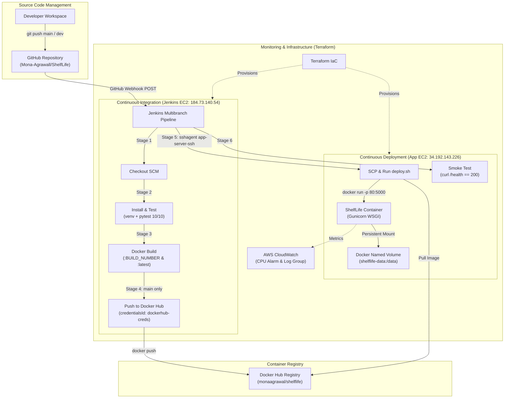

# ShelfLife — Cloud-Native Pantry & Expiry Tracker with Automated CI/CD Pipeline

[](http://184.73.140.54:8080)
[](https://aws.amazon.com/)
[](https://hub.docker.com/r/monaagrawal/shelflife)
[](https://www.terraform.io/)
[](https://pytest.org/)
[](https://www.python.org/)

**ShelfLife** is a cloud-deployed pantry inventory and expiry management web application accompanied by an automated, production-grade **CI/CD pipeline**. The system automatically tests, containerizes, pushes, provisions, and deploys application updates to Amazon Web Services (AWS) using **Git, Jenkins, Docker, and Terraform**.

The application tracks food items and dynamically categorizes their status as **Fresh**, **Expiring Soon** (within 3 days), or **Expired**. The core engineering deliverable is an end-to-end, zero-downtime, branch-aware DevOps workflow adhering to modern Site Reliability Engineering (SRE) and Continuous Delivery best practices.

---

## 📑 Table of Contents

- [System Architecture](#-system-architecture)
- [DevOps Tech Stack Matrix](#-devops-tech-stack-matrix)
- [Repository Directory Structure](#-repository-directory-structure)
- [Application Features & Routes](#-application-features--routes)
- [Local Development & Testing](#-local-development--testing)
  - [Run with Python Virtual Environment](#1-run-locally-via-python-virtual-environment)
  - [Run with Docker Compose](#2-run-locally-via-docker-compose)
  - [Run Pytest Suite](#3-automated-testing-pytest)
- [Infrastructure as Code (Terraform)](#-infrastructure-as-code-terraform)
  - [AWS Resources Provisioned](#aws-resources-provisioned)
  - [AWS Academy (Vocareum) vs. Personal Free-Tier Setup](#aws-credentials-setup)
  - [Executing Terraform](#executing-terraform)
- [Jenkins Automated CI/CD Pipeline](#-jenkins-automated-cicd-pipeline)
  - [Pipeline Workflow & Branch Strategy](#pipeline-workflow--branch-strategy)
  - [Stage-by-Stage Pipeline Breakdown](#stage-by-stage-pipeline-breakdown)
  - [Jenkins Credentials Configuration](#jenkins-credentials-configuration)
  - [GitHub Webhook Integration](#github-webhook-integration)
- [Live Deployment Verification](#-live-deployment-verification)
- [DevOps Troubleshooting Guide](#-devops-troubleshooting-guide)
- [Future Enhancements](#-future-enhancements)

---

## Screenshots


## 🏗 System Architecture

The project utilizes a two-tier cloud topology on AWS: a **Jenkins CI/CD Orchestration Server** and an **Application Hosting Server**, interconnected via automated GitHub Webhooks and secured SSH agents.

### 1. High-Level CI/CD Workflow (ASCII)

```
┌─────────────────┐       git push        ┌──────────────────┐
│ Developer Local │──────────────────────▶│ GitHub Repo      │
│  (main / dev)   │                       │ (Mona-Agrawall/  │
└─────────────────┘                       │  ShelfLife)      │
                                          └────────┬─────────┘
                                                   │ Webhook Event
                                                   ▼
┌────────────────────────────────────────────────────────────┐
│                Jenkins CI/CD Server (EC2)                  │
│                                                            │
│   ┌──────────┐     ┌───────────┐     ┌──────────────┐     │
│   │ Checkout │ ──▶ │ Pytest    │ ──▶ │ Docker Build │     │
│   │ SCM      │     │ (10 Test) │     │ (Image:Tag)  │     │
│   └──────────┘     └───────────┘     └──────┬───────┘     │
│                                             │              │
│   ┌────────────┐   ┌────────────┐   ┌───────▼────────┐     │
│   │ Smoke Test │ ◀─│ SSH Deploy │ ◀─│ Docker Hub Push│     │
│   │ (HTTP 200) │   │ (app-ssh)  │   │ (monaagrawal)  │     │
│   └────────────┘   └────────────┘   └────────────────┘     │
└──────────────────────────┬─────────────────────────────────┘
                           │ SSH: docker pull & run
                           ▼
┌────────────────────────────────────────────────────────────┐
│              Application Production Host (EC2)             │
│                                                            │
│   ┌────────────────────────────────────────────────────┐   │
│   │ Docker Engine (Container: shelflife, Port: 80)     │   │
│   │   ├── Gunicorn WSGI Server (2 Workers)             │   │
│   │   └── Flask App (0.0.0.0:5000)                     │   │
│   └──────────────────────┬─────────────────────────────┘   │
│                          │ Persistent SQLite Mount         │
│   ┌──────────────────────▼─────────────────────────────┐   │
│   │ Docker Named Volume: shelflife-data (/data)        │   │
│   └────────────────────────────────────────────────────┘   │
│                          │ Metrics & Alarms                │
│   ┌──────────────────────▼─────────────────────────────┐   │
│   │ AWS CloudWatch (CPU > 70% Metric Alarm & Logs)     │   │
│   └────────────────────────────────────────────────────┘   │
└────────────────────────────────────────────────────────────┘
```

### 2. Infrastructure Flowchart (Mermaid)



---

## 🧰 DevOps Tech Stack Matrix

| Tool | Category | Version | Role in ShelfLife |
|---|---|---|---|
| **AWS EC2** | Cloud Compute | Ubuntu 22.04 LTS | Hosts Jenkins CI and Production Application Server instances |
| **AWS CloudWatch** | Observability | AWS Native | Tracks App Server CPU utilization (> 70% alarm) and `/shelflife/app` logs |
| **AWS VPC & EIP** | Cloud Networking | AWS Native | Default VPC, Elastic IPs for static hostnames, and restricted Security Groups |
| **Terraform** | IaC (Provisioning) | `>= 1.5.0` | Automates provisioning of EC2, Key Pairs, Security Groups, EIPs, and Alarms |
| **Docker** | Containerization | `29.x` / `python:3.11-slim` | Provides isolated, lightweight, non-root execution for the Flask app |
| **Docker Hub** | Registry | Cloud | Hosts versioned (`:BUILD_NUMBER`) and `:latest` container images |
| **Jenkins** | CI/CD Engine | `2.580+` (Java 21) | Multibranch pipeline runner automating tests, packaging, publishing, and deploy |
| **Git & GitHub** | Version Control | `2.34+` | Source control, feature branch branching strategy, and Webhook triggers |
| **Flask** | Web Application | `3.0.3` | Python web application using Application Factory pattern (`create_app`) |
| **SQLite** | Database | `3.x` | Embedded relational storage persisted on Docker volume `/data` |
| **Gunicorn** | WSGI Server | `22.0.0` | Multi-worker production WSGI server serving Flask on port 5000 |
| **Pytest** | Automated Testing | `8.2.2` | Runs 10 comprehensive unit/integration tests with JUnit XML generation |

---

## 📁 Repository Directory Structure

```
DevOps/
├── .dockerignore                 # Excludes venv, pycache, and sensitive state from container
├── .gitattributes                # Enforces Linux LF line endings for scripts & pipelines
├── .gitignore                    # Excludes secrets (*.pem, *.tfvars), databases, and cache
├── Dockerfile                    # Multi-stage-cached Python 3.11-slim non-root image
├── Jenkinsfile                   # Declarative CI/CD pipeline (Checkout -> Test -> Build -> Push -> Deploy -> Smoke)
├── README.md                     # Comprehensive project documentation and guides
├── docker-compose.yml            # Local multi-container development definition
├── pytest.ini                    # Pytest configuration with JUnit XML output options
├── requirements.txt              # Pinned Python production and testing dependencies
├── app/
│   ├── app.py                    # Flask App Factory (create_app), routes, and get_status() logic
│   ├── static/
│   │   └── style.css             # Responsive custom CSS (status highlights, cards, tables)
│   └── templates/
│       ├── base.html             # Base layout template with navigation and flash messages
│       ├── index.html            # Dashboard (category breakdown, status summary cards)
│       ├── add.html              # Item entry form with server-side field validation
│       ├── expiring.html         # Expiring in 3 days & expired items view (red highlights)
│       └── inventory.html        # Comprehensive inventory list with deletion controls
├── docs/
│   ├── architecture.md           # Deep-dive architecture overview, data flow, and Mermaid chart
│   └── project-report.md         # Academic report template with 10 viva screenshot placeholders
├── scripts/
│   └── deploy.sh                 # Zero-downtime server deployment script called by Jenkins over SSH
├── terraform/
│   ├── main.tf                   # AWS Provider, EC2 instances, EIPs, SGs, CloudWatch, TLS Key Pair
│   ├── variables.tf              # Input variables (region, instance_type, allowed_cidr, etc.)
│   ├── outputs.tf                # Outputs (Jenkins URL, App URL, SSH connection strings)
│   ├── versions.tf               # Terraform and AWS/TLS provider version constraints
│   ├── terraform.tfvars.example  # Safe template for local configuration (ignored by git)
│   ├── user_data_jenkins.sh      # Cloud-init bootstrap: Java 21, Jenkins, Docker, Swap, Git
│   └── user_data_app.sh          # Cloud-init bootstrap: Docker, /data volume, user permissions
└── tests/
    └── test_app.py               # 10 Pytest unit and integration test fixtures using temp DB
```

---

## 🌐 Application Features & Routes

The ShelfLife application is intentionally structured with pure, testable domain logic:

```
get_status(expiry_date, today=None)
  ├── "expired"       : expiry_date < today
  ├── "expiring_soon" : 0 <= (expiry_date - today).days <= 3
  └── "fresh"         : (expiry_date - today).days > 3
```

### Route Table

| Route | Method | Purpose |
|---|:---:|---|
| **`/`** | `GET` | **Dashboard**: Displays counters for *Expired*, *Expiring Soon*, and *Fresh* items, plus a per-category breakdown table. |
| **`/add`** | `GET`, `POST` | **Add Item Form**: Validates item name, category (*Dairy, Vegetables, Fruits, Grains, Snacks, Beverages, Other*), positive quantity, and ISO-8601 expiry date. |
| **`/expiring`** | `GET` | **Alerts View**: Displays items expiring within 3 days, with expired items highlighted in warning red. |
| **`/inventory`** | `GET` | **Full Inventory**: Chronologically sorted table of all pantry items with individual delete buttons. |
| **`/inventory/delete/<id>`** | `POST` | **Deletion Endpoint**: Safely removes the specified item from SQLite and redirects with flash notification. |
| **`/health`** | `GET` | **Healthcheck**: Returns JSON `{"status": "ok"}` with HTTP 200. Used by Docker container healthcheck and Jenkins Smoke Test. |

---

## 💻 Local Development & Testing

### 1. Run Locally via Python Virtual Environment

```bash
# Clone the repository
git clone https://github.com/Mona-Agrawall/ShelfLife.git
cd ShelfLife

# Create and activate virtual environment
python -m venv venv

# Windows:
venv\Scripts\activate
# Linux/macOS:
source venv/bin/activate

# Install dependencies
pip install --upgrade pip
pip install -r requirements.txt

# Run the Flask development server
python app/app.py
# Access application at http://localhost:5000
```

### 2. Run Locally via Docker Compose

```bash
# Build image and start container in background with persistent volume
docker compose up --build -d

# Check running status and healthcheck
docker compose ps

# Access application at http://localhost:5000

# View application logs
docker compose logs -f

# Tear down environment
docker compose down
```

### 3. Automated Testing (Pytest)

The test suite runs against an isolated, temporary SQLite database to guarantee tests never mutate live data:

```bash
# Execute all 10 tests with verbose output
pytest -v

# Output JUnit XML report (parsed by Jenkins in CI)
pytest --junitxml=test-results.xml -v
```

#### Test Suite Breakdown

| Test Case | Target Tested | Verification |
|---|---|---|
| `test_get_status_expired` | `get_status()` pure logic | Verifies past dates return `"expired"` |
| `test_get_status_today` | `get_status()` pure logic | Verifies today's date returns `"expiring_soon"` |
| `test_get_status_3_days` | `get_status()` pure logic | Verifies exactly 3 days left returns `"expiring_soon"` |
| `test_get_status_4_days` | `get_status()` pure logic | Verifies 4 days left returns `"fresh"` |
| `test_health_endpoint` | `GET /health` | Validates HTTP 200 and JSON response `{"status": "ok"}` |
| `test_dashboard_renders` | `GET /` | Verifies HTTP 200 and HTML contains `"Dashboard"` |
| `test_expiring_page` | `GET /expiring` | Verifies HTTP 200 and table rendering |
| `test_inventory_page` | `GET /inventory` | Verifies HTTP 200 and inventory view |
| `test_add_item_post` | `POST /add` | Inserts valid item and verifies HTTP 302 redirect to `/` |
| `test_delete_item` | `POST /inventory/delete/<id>` | Adds an item, deletes it, and confirms it is gone from DB |

---

## ☁️ Infrastructure as Code (Terraform)

All AWS cloud infrastructure is fully automated inside `terraform/`.

### AWS Resources Provisioned

1. **EC2 Instances (`t3.small` / Ubuntu 22.04 LTS)**:
   - `jenkins_server`: Automated Java 21, Jenkins 2.580+, Docker Engine, 2GB swap file, Git.
   - `app_server`: Docker Engine, `/data` volume permissions, and container runtime.
2. **Elastic IP Addresses (EIP)**:
   - Fixed static public IPs for both instances ensuring IPs survive stop/reboot cycles.
3. **Security Groups**:
   - `shelflife-jenkins-sg`: Inbound TCP 22 (SSH) and 8080 (Jenkins Web UI).
   - `shelflife-app-sg`: Inbound TCP 22 (SSH), 80 (HTTP Production), and 5000 (Direct App Port).
4. **Automated Key Pair**:
   - Generates 4096-bit RSA key pair (`shelflife-key`), writes private key to `shelflife-key.pem` with `0400` permissions.
5. **Amazon CloudWatch**:
   - Log group `/shelflife/app` (7-day retention).
   - Metric Alarm (`shelflife-app-cpu-high`) triggering when CPU > 70% for two 5-minute periods.

---

### AWS Credentials Setup

#### Option A: AWS Academy (Vocareum Learner Lab)
1. Go to your Vocareum Lab Console and click **AWS Details** ➔ **Show AWS CLI credentials**.
2. Copy the credentials and place them in `~/.aws/credentials`:
   ```ini
   [default]
   aws_access_key_id = ASIA...
   aws_secret_access_key = ...
   aws_session_token = IQoJb3JpZ2luX2VjEPv...
   ```
3. Set your region in `~/.aws/config`:
   ```ini
   [default]
   region = us-east-1
   output = json
   ```
4. *Important*: AWS Academy uses pre-configured IAM roles. Set `instance_profile_name = "LabInstanceProfile"` in `terraform/terraform.tfvars`.

#### Option B: Personal AWS Free-Tier Account
1. Create an IAM User in AWS Console with `AmazonEC2FullAccess` and `CloudWatchFullAccess`.
2. Generate an Access Key and Secret Key. Run `aws configure` in your terminal.
3. Keep `instance_profile_name = ""` in `terraform/terraform.tfvars`.

---

### Executing Terraform

```bash
cd terraform

# Create your personal variable file from example
cp terraform.tfvars.example terraform.tfvars

# Edit terraform.tfvars:
# region = "us-east-1"
# instance_type = "t3.small"
# allowed_cidr = "0.0.0.0/0"
# instance_profile_name = "LabInstanceProfile" # (Set on AWS Academy)

# Initialize Terraform providers
terraform init

# Review execution plan (13 resources to create)
terraform plan

# Apply infrastructure deployment
terraform apply -auto-approve

# View deployment outputs
terraform output
```

---

## ⚙️ Jenkins Automated CI/CD Pipeline

The automated build system is defined as **Pipeline as Code** in `Jenkinsfile`.

### Pipeline Workflow & Branch Strategy

- **`dev` Branch**: Runs continuous integration only (**Checkout** ➔ **Install & Test** ➔ **Build Docker Image**). It verifies code quality without touching production.
- **`main` Branch**: Runs the full continuous delivery lifecycle (**Checkout** ➔ **Install & Test** ➔ **Build Docker Image** ➔ **Push to Docker Hub** ➔ **Deploy to App Server** ➔ **Smoke Test**).

```
   Branch: dev                       Branch: main
  ─────────────                     ──────────────
  1. Checkout SCM                   1. Checkout SCM
  2. Install & Test (pytest)        2. Install & Test (pytest)
  3. Build Docker Image             3. Build Docker Image
  ─────────────────────             4. Push to Docker Hub
  (Stops here safely)               5. Deploy to App Server (SSH)
                                    6. Smoke Test (/health == 200)
```

### Stage-by-Stage Pipeline Breakdown

1. **Stage 1: Checkout SCM**
   - Automatically checks out the commit that triggered the build using Git SCM plugin.
2. **Stage 2: Install & Test**
   - Installs/updates isolated Python virtual environment (`python3 -m venv venv`).
   - Upgrades `pip` and installs pinned packages from `requirements.txt`.
   - Runs `pytest --junitxml=test-results.xml -v`.
   - Publishes test results using Jenkins `junit` step in the `post { always }` block.
3. **Stage 3: Build Docker Image**
   - Builds container image with multi-tagging:
     ```bash
     docker build -t monaagrawal/shelflife:${BUILD_NUMBER} -t monaagrawal/shelflife:latest .
     ```
4. **Stage 4: Push to Docker Hub (`when { branch 'main' }`)**
   - Securely binds Docker credentials with `withCredentials([usernamePassword(credentialsId: 'dockerhub-creds', ...)])`.
   - Authenticates without printing password to console:
     ```bash
     echo "$DOCKER_PASS" | docker login -u "$DOCKER_USER" --password-stdin
     ```
   - Pushes both `:BUILD_NUMBER` and `:latest` tags.
5. **Stage 5: Deploy to App Server (`when { branch 'main' }`)**
   - Injects SSH credentials via `sshagent(['app-server-ssh'])`.
   - Uses `scp` to transfer `scripts/deploy.sh` to the application host.
   - Executes remote deployment:
     ```bash
     ssh -o StrictHostKeyChecking=no ubuntu@$APP_SERVER_IP \
       "sed -i 's/\r$//' /tmp/deploy.sh && chmod +x /tmp/deploy.sh && IMAGE=monaagrawal/shelflife:${BUILD_NUMBER} /tmp/deploy.sh"
     ```
   - On the server, `deploy.sh` pulls the image, stops the old container, and starts the new container with `-p 80:5000 -v shelflife-data:/data --restart unless-stopped`.
6. **Stage 6: Smoke Test (`when { branch 'main' }`)**
   - Issues active HTTP polling requests to `http://$APP_SERVER_IP/health` over 6 attempts with 5-second backoffs.
   - Fails the build immediately if `/health` does not respond with HTTP 200.
7. **Post Actions**
   - On success: Echos application URL and deployment details.
   - Always: Executes `docker image prune -f` to clean up dangling build layers and preserve disk space.

---

### Jenkins Credentials Configuration

The following credentials must exist in Jenkins under **Manage Jenkins** ➔ **Credentials**:

| Credential ID | Kind | Description / Value |
|---|---|---|
| **`dockerhub-creds`** | Username with password | Docker Hub username (`monaagrawal`) and Personal Access Token (PAT with **Read & Write** scope) |
| **`app-server-ssh`** | SSH Username with private key | Username: `ubuntu`. Private Key: Full content of `terraform/shelflife-key.pem` (4096-bit RSA key) |

---

### GitHub Webhook Integration

To trigger automatic deployments on `git push`:
1. Navigate to your GitHub repository: **Settings ➔ Webhooks ➔ Add webhook**.
2. **Payload URL**:
   ```
   http://184.73.140.54:8080/github-webhook/
   ```
3. **Content type**: `application/json`
4. **Which events**: *Just the push event*
5. Save webhook. GitHub will send a test ping returning green `200 OK`.

---

## 🚀 Live Deployment Verification

The system is deployed and verified live:

- **Jenkins Management Dashboard**: [http://184.73.140.54:8080](http://184.73.140.54:8080)
- **Live ShelfLife Application**: [http://34.192.143.226](http://34.192.143.226)
- **Healthcheck JSON Endpoint**: [http://34.192.143.226/health](http://34.192.143.226/health)
- **Add Pantry Item Endpoint**: [http://34.192.143.226/add](http://34.192.143.226/add)
- **Expiring Soon Endpoint**: [http://34.192.143.226/expiring](http://34.192.143.226/expiring)
- **Pantry Inventory Endpoint**: [http://34.192.143.226/inventory](http://34.192.143.226/inventory)

### Quick Verification via CLI

```bash
# Verify Healthcheck
curl -s http://34.192.143.226/health
# Response: {"status":"ok"}

# Verify HTTP Status
curl -s -o /dev/null -w "%{http_code}\n" http://34.192.143.226/
# Response: 200
```

---

## 🛠 DevOps Troubleshooting Guide

| Issue | Root Cause | Solution |
|---|---|---|
| **Jenkins Out Of Memory (OOM)** | Java Heap + Docker compilation exceeding 1 GB memory on EC2. | Enable 2GB swap space (`user_data_jenkins.sh` handles this automatically) or run on `t3.small` instead of `t2.micro`. |
| **Jenkins GPG Key Expired** | Jenkins rotated repository signing key (`jenkins.io-2023.key` expired in 2026). | Use the updated key: `https://pkg.jenkins.io/debian-stable/jenkins.io-2026.key`. |
| **Jenkins Requires Java 21** | Modern Jenkins packages (`2.580+`) dropped Java 17 support. | Install `openjdk-21-jdk` and set default JVM via `update-alternatives`. |
| **Docker: permission denied in CI** | `jenkins` user is not part of the `docker` OS group. | Run `sudo usermod -aG docker jenkins` and restart Jenkins (`sudo systemctl restart jenkins`). |
| **Docker Hub Push: `insufficient scopes`** | Docker Hub PAT was generated with "Read-only" permissions. | Create a new PAT at [hub.docker.com](https://hub.docker.com/settings/security) with **Read & Write** access and update `dockerhub-creds` in Jenkins. |
| **Docker Tag Invalid / Uppercase** | Docker repository names must be strictly lowercase. | Set `DOCKERHUB_USER = 'monaagrawal'` in lowercase in `Jenkinsfile`. |
| **SSH `bad permissions` on Key** | Windows NTFS permissions allow other users read access to `.pem`. | Strip inherited permissions: `icacls shelflife-key.pem /inheritance:r` and grant user read: `icacls shelflife-key.pem /grant:r "$($env:USERNAME):(R)"`. |
| **SSH `bad interpreter: \r`** | Deploy script checked out on Windows has CRLF line endings. | The repository includes `.gitattributes` (`eol=lf`) and `deploy.sh` runs `sed -i 's/\r$//' /tmp/deploy.sh` prior to execution. |
| **AWS Academy Credentials Expired** | Vocareum STS session tokens expire every 4 hours. | Re-copy credentials from Vocareum Lab into `~/.aws/credentials`. |
| **Container Port 80 Not Reachable** | AWS EC2 Security Group inbound rules missing HTTP port 80. | Verify `app_sg` in `terraform/main.tf` permits port 80 from `0.0.0.0/0`. |

---

## 🔮 Future Enhancements

1. **Automated Expiry Push / Email Notifications**: Integrate AWS SES or Twilio to send automated notifications when pantry items are 2 days from expiring.
2. **Kubernetes (EKS / K8s) Deployment**: Migrate single-container EC2 deployment to a Helm chart on Amazon EKS with horizontal pod autoscaling.
3. **Database Migration to AWS RDS PostgreSQL**: Decouple SQLite storage into Amazon RDS PostgreSQL for high-availability multi-instance clustering.
4. **Barcode Scanning via Mobile Camera**: Add QuaggaJS / ZXing barcode scanner to the `/add` endpoint to auto-populate product names and categories.

---

## 👩‍💻 Author & Academic Submission

- **Project**: ShelfLife — Cloud & DevOps Academic Project
- **Developer**: Mona Agrawal
- **GitHub**: [https://github.com/Mona-Agrawall/ShelfLife](https://github.com/Mona-Agrawall/ShelfLife)
- **Docker Hub**: [https://hub.docker.com/r/monaagrawal/shelflife](https://hub.docker.com/r/monaagrawal/shelflife)
