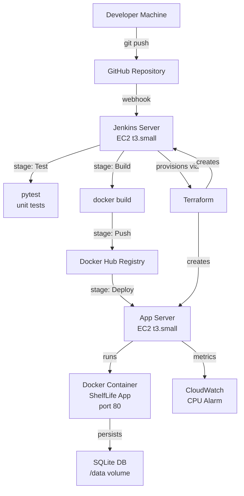

# ShelfLife — System Architecture

## 1. Overview

ShelfLife is a cloud-deployed pantry expiry tracker built on a two-tier infrastructure hosted on AWS. The system comprises a lightweight Flask web application containerized with Docker, a fully automated Jenkins CI/CD pipeline, and AWS infrastructure provisioned with Terraform as code. The pipeline automatically tests, builds, and deploys the application on every push to the `main` branch, while push events to other branches trigger only the test and build stages (no deployment).

The goal of the architecture is to demonstrate a real-world DevOps workflow: code changes flow from a developer's local machine through version control, automated testing, container image registry, and finally into a live production server — with no manual intervention required after the initial infrastructure setup.

---

## 2. Component Descriptions

### Flask Application
- **Framework**: Python 3 / Flask 3.x
- **Role**: Serves HTML pages for the pantry dashboard, item addition form, expiring items list, and full inventory. Provides a `/health` JSON endpoint for smoke testing.
- **Database interaction**: Uses Python's built-in `sqlite3` module. The app factory (`create_app()`) accepts a configurable DB path, making it easy to swap between production and test databases.

### SQLite Database
- **Role**: Stores all pantry items (name, category, quantity, expiry date, date added).
- **Why SQLite**: For a single-container deployment, SQLite requires zero configuration and no separate database server. Data is persisted via a Docker volume mounted at `/data` inside the container.
- **Limitation**: Not suited for multi-process or multi-instance scaling (see Scaling Notes below).

### Docker & Docker Hub
- **Docker**: Packages the Flask app and its Python dependencies into a reproducible container image. A non-root `appuser` is used inside the container for security.
- **Docker Hub**: Acts as the image registry. Jenkins pushes a new tagged image on every successful main-branch build. The app server always pulls the latest image before restarting the container.

### Jenkins (CI/CD Server)
- **Hosting**: EC2 t3.small instance provisioned by Terraform.
- **Role**: Orchestrates the full CI/CD pipeline via a `Jenkinsfile` stored in the repository (Pipeline as Code).
- **Trigger**: GitHub webhooks fire on every push. The `Jenkinsfile` uses `when { branch 'main' }` conditions to gate the Push and Deploy stages to the main branch only.
- **Credentials**: Docker Hub credentials and the app server SSH private key are stored as Jenkins credentials and injected into pipeline stages at runtime.

### Terraform (Infrastructure as Code)
- **Role**: Provisions all AWS resources declaratively: EC2 instances, security groups, Elastic IPs, key pairs, and CloudWatch alarms.
- **State**: Terraform state is stored locally (`.tfstate`). For a team environment, this should be migrated to an S3 backend with DynamoDB locking.

### AWS EC2
- **Jenkins Server**: Runs Jenkins, Docker, and the pipeline toolchain.
- **App Server**: Runs the Docker container serving the ShelfLife application on port 80. Receives deployments via SSH from Jenkins.

### AWS CloudWatch
- **Role**: Monitors CPU utilization on the app server. An alarm is configured to trigger when CPU exceeds 80% for two consecutive 5-minute periods.
- **Future use**: Log groups can be added to aggregate application logs for centralized monitoring.

---

## 3. Data Flow

The end-to-end data flow through the system is:

1. **Developer** commits code and pushes to GitHub.
2. **GitHub** fires a webhook POST to Jenkins at `http://<jenkins-ip>:8080/github-webhook/`.
3. **Jenkins** receives the webhook, identifies the branch, and starts the matching pipeline run.
4. **Checkout stage**: Jenkins clones the repository.
5. **Install & Test stage**: Jenkins creates a Python virtual environment, installs dependencies, and runs `pytest`. If any test fails, the pipeline aborts here.
6. **Build stage**: Jenkins runs `docker build`, tagging the image with both the Git commit SHA and `latest`.
7. **Push stage** *(main branch only)*: Jenkins authenticates to Docker Hub using stored credentials and pushes both tags.
8. **Deploy stage** *(main branch only)*: Jenkins SSHs into the app server, pulls the new image, stops and removes the existing container, and starts a fresh container bound to port 80 with the `/data` volume.
9. **Smoke Test stage**: Jenkins sends a `curl` request to `http://<app-ip>/health` and verifies a 200 response.
10. **End user** browses to `http://<app-ip>` and interacts with the live application.

---

## 4. Architecture Diagram

---

## 5. Security Considerations

### Non-root Docker User
The `Dockerfile` creates a dedicated system user (`appuser`) and switches to it before the container's entry point. This ensures the Flask process does not run as root inside the container, limiting the blast radius of a potential application compromise.

### SSH Key Authentication
All SSH access to EC2 instances (developer to servers, Jenkins to app server) uses RSA key pairs — no password authentication. The private key (`.pem`) is stored only in Jenkins credentials (encrypted at rest) and never committed to the repository (`.gitignore` excludes `*.pem` and `*.key`).

### Security Groups (Principle of Least Privilege)
- **Jenkins server**: Inbound rules allow only port 8080 (Jenkins UI) and port 22 (SSH). Port 8080 should be restricted to known developer IPs in a production setup.
- **App server**: Inbound rules allow only port 80 (HTTP) and port 22 (SSH). Port 22 access from Jenkins is facilitated by the shared key pair.

### Credentials Management
Sensitive values (Docker Hub token, SSH private key) are stored as Jenkins Credentials objects and injected into pipeline environment variables at runtime. They are never stored in the `Jenkinsfile` or any committed file.

### `.gitignore` Exclusions
The `.gitignore` explicitly excludes `*.pem`, `*.key`, `.env`, `terraform.tfvars` (which may contain IPs or secrets), and `*.tfstate` (which may contain resource details). The example file `terraform.tfvars.example` is committed as a safe template.

---

## 6. Scaling Notes

The current architecture is intentionally minimal (single-instance per tier) to fit within AWS Free Tier / Academy lab budgets. For a production-grade deployment, consider the following:

| Concern | Current approach | Production approach |
|---------|-----------------|---------------------|
| Database | SQLite file in Docker volume | Amazon RDS (PostgreSQL/MySQL) or managed DB |
| App server | Single EC2 | Auto Scaling Group behind an ALB |
| Container orchestration | `docker run` via SSH | Amazon ECS (Fargate) or Kubernetes (EKS) |
| CI/CD agent | Single Jenkins master | Jenkins agents / GitHub Actions |
| State management | Local `.tfstate` | S3 backend + DynamoDB lock table |
| HTTPS | None (HTTP only) | ACM certificate + ALB HTTPS listener |
| Secrets | Jenkins credentials | AWS Secrets Manager or Parameter Store |

SQLite's write-lock model means only one writer at a time — perfectly adequate for a demo or low-traffic personal tool, but it must be replaced with a client-server database before scaling the app horizontally.
